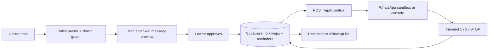

# Quick Notes follow-up reminders

A small clinic operations tool for turning a short doctor note into an editable follow-up draft, then sending approved appointment reminders. It does not provide medical advice. Outbound messages come from fixed, reviewed templates; clinical note text is removed from parsing and erased when a draft is approved.

## Local setup

1. Use Node.js 20.11 or later and install dependencies with `npm ci`.
2. Create a free Supabase project and apply migrations in `supabase/migrations/` (see [docs/DEPLOY.md](docs/DEPLOY.md)).
3. Copy `.env.example` to `.env.local` and fill in the Supabase URL, anon key, service role key, a 32+ character cron secret, and `APP_BASE_URL=http://localhost:3000`. Keep secrets out of source control.
4. Create the doctor and receptionist staff users as described in the deploy guide. Seed fictional demo records with `npm run db:seed`.
5. Run `npm run dev` and open `http://localhost:3000`.

## Scripts

- `npm run dev` — local Next.js server
- `npm run lint` — ESLint
- `npm run typecheck` — strict TypeScript check
- `npm test` — Vitest (timezone forced to UTC)
- `npm run test:safety` — safety, parser, and outbound template checks
- `npm run db:seed` — idempotent demo seed; refuses `VERCEL_ENV=production`

## Architecture

Routes validate requests and call server-side services. Supabase RLS protects staff data; privileged reminder operations use the server-only service role. A scheduler calls the bearer-protected tick endpoint every five minutes (the Vercel Hobby cron is only a daily backstop). The default provider is `console`; live sends are disabled unless explicitly enabled.

## Demo flow

Sign in as a doctor, parse a short note such as `Ramesh Patel 5 din baad`, review the date and fixed preview, then approve. Use the console provider for a no-network demonstration, or configure the Twilio sandbox and join demo phones first. Replies `1`, `2`, and `STOP` exercise confirmation, receptionist follow-up, and opt-out. Seed records use fictional names and non-routable placeholder numbers. `DEMO_PHONE_1..3` can replace up to three seed numbers for team members who have explicitly consented; seeded records are never eligible for sends.

## Limits

This prototype is single-clinic and uses the Twilio WhatsApp sandbox. Production WhatsApp requires an approved sender and templates and may incur fees. Modeled revenue values are assumptions, not measured results. See [docs/SAFETY.md](docs/SAFETY.md) and [docs/DEPLOY.md](docs/DEPLOY.md).
